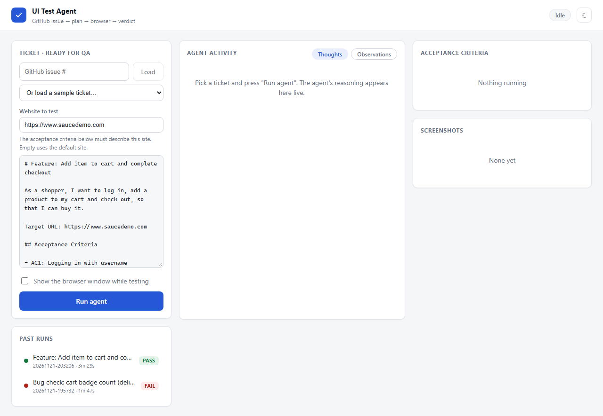

# Autonomous UI Test Agent

An LLM agent (Gemini Developer API + Playwright) that reads a GitHub issue, turns its **Acceptance Criteria** into
test steps, drives a real browser to execute them, and reports **PASS / FAIL / BLOCKED** with evidence.
No hardcoded selectors: the model sees the page as an accessibility tree and picks elements by role and name.

Target app: [saucedemo.com](https://www.saucedemo.com) (login -> add to cart -> checkout).

## Quick start (about 5 minutes)

Requires Python 3.10+ and a free [Gemini API key](https://aistudio.google.com/apikey) (Google account, no credit card).

```powershell
python -m venv .venv
.venv\Scripts\activate
pip install -r requirements.txt
playwright install chromium

copy .env.example .env        # then paste your GEMINI_API_KEY into .env

python -m agent.main --issue-file issues/checkout-flow.md          # expected: PASS
python -m agent.main --issue-file issues/failing-cart-badge.md     # expected: FAIL (deliberate)
```

Add `--headed` to watch the browser. Results land in `evidence/run-<timestamp>/`:

| File | Contents |
|------|----------|
| `agent.log` | The agent's reasoning trail: OBSERVE / THOUGHT / ACTION / RESULT per turn |
| `screenshots/` | One screenshot per action, plus one per criterion |
| `video/*.webm` | Full video recording |
| `report.md`, `report.json` | Final automated pass/fail report |

Exit codes: `0` pass, `1` fail, `2` blocked (inconclusive), `3` configuration/input error, `4` unexpected crash.

## Web dashboard (optional)

A separate React + FastAPI project in [agent-dashboard/](agent-dashboard/) (see its README). It starts the agent's
CLI, streams the reasoning live, shows per-criterion cards and screenshots, and can load and run a GitHub issue.

```powershell
cd agent-dashboard
python -m dashboard
```

## Using a real GitHub issue

1. Put `GITHUB_TOKEN` (repo scope) and `GITHUB_REPO=owner/repo` in `.env`.
2. Create an issue shaped like [issues/checkout-flow.md](issues/checkout-flow.md): a `## Acceptance Criteria` list
   and an optional `Target URL:` line.
3. `python -m agent.main --issue 1 --post` runs it and comments the report on the issue (plus a `qa-*` label).

### Automatic trigger on "RFQA" (webhook)

Adding the label `RFQA` to an issue starts the agent.

```powershell
uvicorn agent.triggers.webhook:app --port 8000
ngrok http 8000      # then add <public-url>/webhook as a repo webhook (event: Issues,
                     # content type application/json, secret = GITHUB_WEBHOOK_SECRET)
```

Alternative with no server: [.github/workflows/rfqa.yml](.github/workflows/rfqa.yml) runs the agent on the same
label (add `GEMINI_API_KEY` as a repository secret).

## Project layout

```
agent/                    the test agent (Python package)
  main.py                 CLI entry point:  python -m agent.main
  config.py, models.py    settings and shared data classes
  tickets/                parser.py (issue -> acceptance criteria), github.py (fetch issue, post result)
  llm/                    client.py (Gemini + retry), prompts.py, tool_schemas.py
  browser/                session.py (Playwright, semantic actions, ARIA snapshot)
  pipeline/               planner.py -> executor.py -> verifier.py, loop_guard.py, runner.py (orchestration)
  reporting/              evidence.py (run folder, logs), reporter.py (report.md / report.json)
  triggers/               webhook.py (RFQA label trigger)
agent-dashboard/          optional web dashboard (separate project)
issues/                   sample tickets
docs/                     TEST_PLAN.md, SCENARIOS.md
tests/                    unit tests (no API key or browser needed)
evidence/                 output of runs: logs, screenshots, video, reports
.github/workflows/        GitHub Action for the RFQA trigger
```

See [docs/ARCHITECTURE.md](docs/ARCHITECTURE.md) for the architecture diagrams, [docs/TEST_PLAN.md](docs/TEST_PLAN.md) for design decisions and [docs/SCENARIOS.md](docs/SCENARIOS.md) for what is tested.

## Tests

```powershell
pip install -r requirements-dev.txt
pytest        # parsing, guardrails and the whole pipeline with a fake LLM + browser; no API key or Chromium needed
```

## Notes and limits

- Gemini model names change; set `GEMINI_MODEL` in `.env` to any current model that supports function calling.
  The default is `gemini-3.5-flash-lite`: fast, and it works on the free tier. `gemini-3.5-flash` is stronger but the
  free tier allows only about 20 requests per day for it, which is less than one full run. Newer previews (3.6 to 3.8)
  are often overloaded (503).
- Free-tier limits: the client waits and retries on short rate limits, and stops with a clear message when a daily quota is used up.
- The agent reads the page through the accessibility tree rather than screenshots. Screenshots are saved as evidence only.

## UI dashboard demo

A full browser walkthrough is recorded in [docs/ui-demo/dashboard-walkthrough.webm](docs/ui-demo/dashboard-walkthrough.webm). It demonstrates:

- Loading the dashboard and checking the idle state
- Entering and loading GitHub issue **#1**
- Displaying the issue title, target URL, and acceptance criteria
- Enabling GitHub result posting
- Enabling headed browser mode
- Starting a run for the loaded issue
- Viewing the live activity, acceptance-criteria, screenshot, and past-run panels
- Loading sample tickets and entering ticket markdown
- Enabling and disabling run options

### Recorded screenshots

#### Dashboard and ticket controls



#### GitHub issue loaded


#### Run options


#### Completed run and GitHub posting state


#### Theme switch


### Replay the UI test

Requires the dashboard server on `http://127.0.0.1:8765`.

```powershell
cd agent-dashboard
python -m uvicorn dashboard.app:app --host 127.0.0.1 --port 8765
```

Then run the recorded Playwright walkthrough in another terminal:

```powershell
cd agent-dashboard/frontend
npm ci
npx playwright install chromium
npm run test:ui
```

The walkthrough is in `frontend/tests/dashboard.spec.ts`. Playwright saves screenshots and videos under `frontend/test-results/`.
