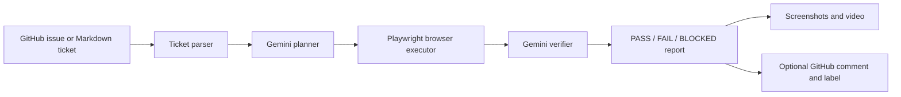
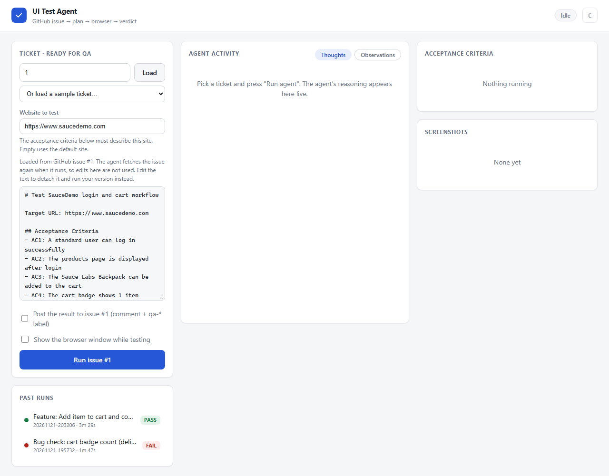
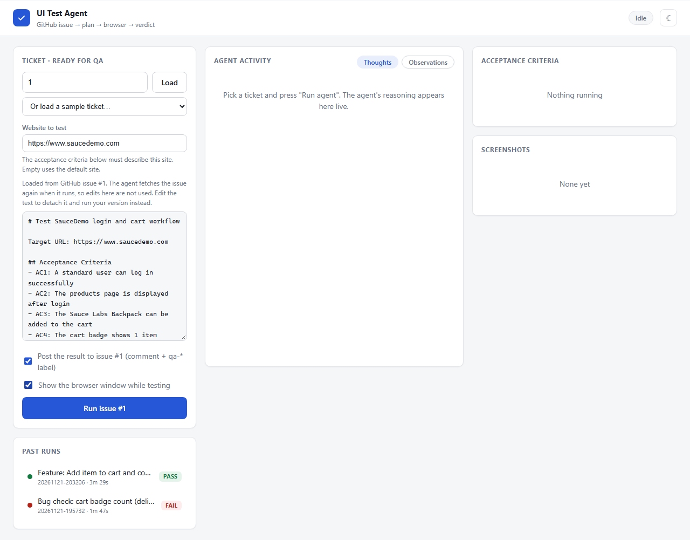
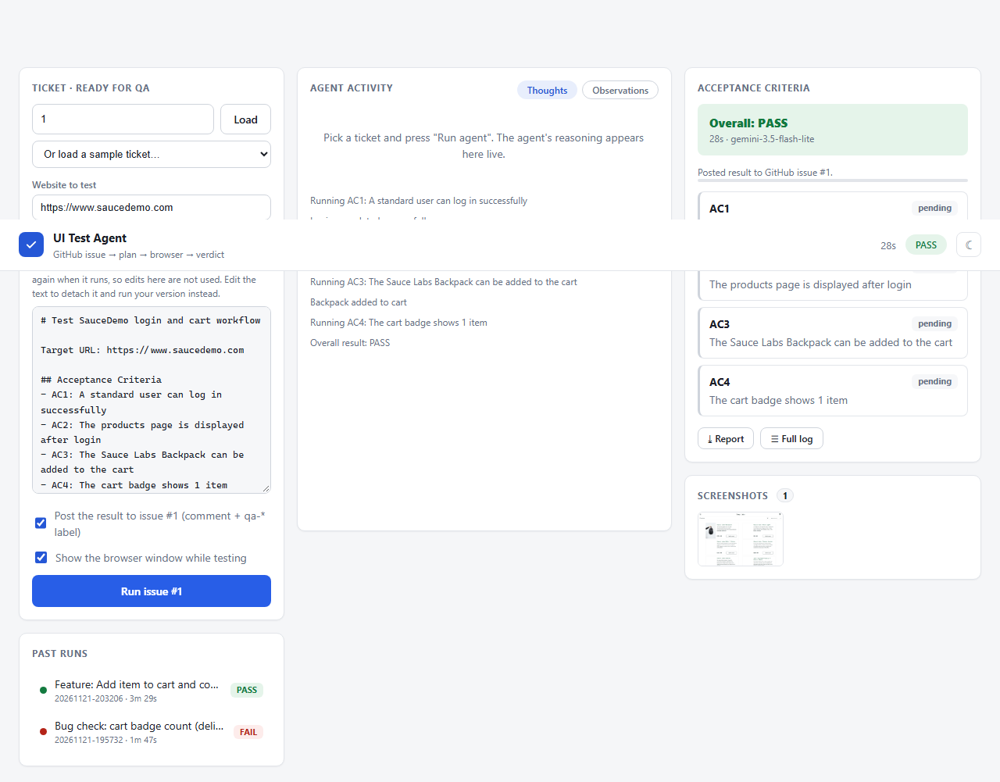
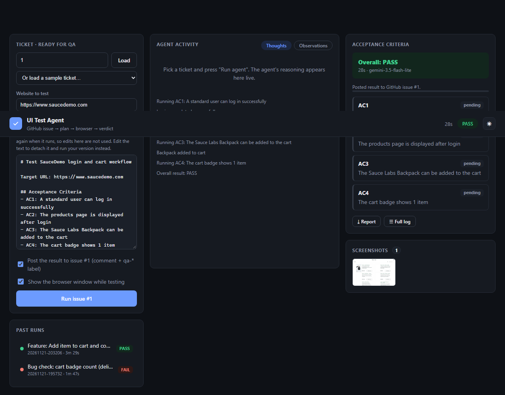

# Autonomous UI Testing Agent

[](https://github.com/Edita1134/Autonomous-UI-Testing-Agent/actions/workflows/tests.yml)
[](https://www.python.org/)
[](https://fastapi.tiangolo.com/)
[](https://react.dev/)

An AI-assisted UI testing agent that converts GitHub issues or Markdown tickets into browser tests. Gemini creates and verifies test scenarios, while Playwright executes them using accessible page roles instead of fragile CSS selectors.

The agent produces **PASS**, **FAIL**, or **BLOCKED** verdicts and saves screenshots, browser video, logs, and machine-readable reports.

**Target application:** [SauceDemo](https://www.saucedemo.com) — login, products, cart, and checkout workflows.

## Features

- Loads acceptance criteria from GitHub issues or local Markdown files
- Plans test steps automatically with Gemini
- Controls Chromium through Playwright and accessibility snapshots
- Stops repeated actions and enforces configured guardrails
- Verifies results against evidence found on the page
- Saves screenshots, WebM recordings, `report.md`, `report.json`, and `agent.log`
- Posts comments and `qa-passed`, `qa-failed`, or `qa-blocked` labels to GitHub
- Provides a React + FastAPI dashboard with live run activity
- Supports GitHub Actions and the `RFQA` webhook trigger

## Quick start

### Requirements

- Python 3.10 or newer
- Node.js 20 or newer for the dashboard UI
- A Gemini API key
- Chromium installed by Playwright

### Install

```powershell
git clone https://github.com/Edita1134/Autonomous-UI-Testing-Agent.git
cd Autonomous-UI-Testing-Agent

python -m venv .venv
.\.venv\Scripts\Activate.ps1
python -m pip install -r requirements.txt
python -m playwright install chromium

Copy-Item .env.example .env
```

Open `.env` and add `GEMINI_API_KEY`. The repository intentionally excludes `.env` from Git.

### Run a sample ticket

```powershell
python -m agent.main --issue-file issues/checkout-flow.md
python -m agent.main --issue-file issues/failing-cart-badge.md
python -m agent.main --issue-file issues/checkout-flow.md --headed
```

Exit codes are `0` for PASS, `1` for FAIL, `2` for BLOCKED, `3` for configuration/input errors, and `4` for unexpected crashes.

### Run evidence

Each run is stored under `evidence/run-<timestamp>/`:

| Artifact | Description |
|---|---|
| `agent.log` | Timestamped observations, thoughts, actions, and results |
| `screenshots/` | Page screenshots captured during the run |
| `video/*.webm` | Complete browser recording |
| `report.md` | Human-readable final report |
| `report.json` | Structured report for dashboards and automation |

## How it works



1. **Ticket parsing** extracts acceptance criteria and an optional target URL.
2. **Planning** converts each criterion into browser actions.
3. **Execution** uses Playwright with role-based accessibility interactions.
4. **Verification** checks reported evidence against the final page state.
5. **Reporting** creates evidence, summaries, and final verdicts.

## Using GitHub issues

Configure `.env` with the repository and token:

```dotenv
GITHUB_REPO=Edita1134/Autonomous-UI-Testing-Agent
GITHUB_TOKEN=
GEMINI_API_KEY=
```

Create an issue with this structure:

```markdown
Target URL: https://www.saucedemo.com

## Acceptance Criteria
- AC1: A standard user can log in successfully
- AC2: The products page is displayed after login
- AC3: The Sauce Labs Backpack can be added to the cart
- AC4: The cart badge shows 1 item
```

Run it from the CLI:

```powershell
python -m agent.main --issue 1
python -m agent.main --issue 1 --post
```

The `--post` option adds a Markdown report comment and replaces the previous `qa-passed`, `qa-failed`, or `qa-blocked` label.

## Automatic GitHub trigger

Two trigger modes are included:

- **Webhook:** run `uvicorn agent.triggers.webhook:app --port 8000`, expose it with an HTTPS tunnel, and configure the GitHub repository webhook for issue label events.
- **GitHub Actions:** add `GEMINI_API_KEY` and `GITHUB_TOKEN` repository secrets; applying `RFQA` runs the workflow in `.github/workflows/rfqa.yml`.

## Web dashboard

The dashboard combines a React + TypeScript interface with a FastAPI backend.

```powershell
cd agent-dashboard
python -m pip install -r requirements.txt
python -m dashboard
```

Open `http://127.0.0.1:8765`. The dashboard displays live agent activity, run progress, acceptance-criterion verdicts, screenshots, past runs, and GitHub posting status.

For frontend development:

```powershell
cd agent-dashboard/frontend
npm ci
npm run dev
npm run build
```

Keep the Python dashboard server running on port `8765`; Vite proxies `/api` and `/evidence` requests to it.

## Project structure

```text
agent/                    Core agent package
  main.py                 CLI entry point
  tickets/                Markdown and GitHub ticket handling
  llm/                    Gemini client, prompts, and tool schemas
  browser/                Playwright browser session
  pipeline/               Planning, execution, verification, and guardrails
  reporting/              Evidence and report generation
  triggers/               RFQA webhook trigger

agent-dashboard/          React and FastAPI dashboard
  dashboard/              Backend API and subprocess runner
  frontend/src/           React TypeScript source
  frontend/tests/         Playwright UI tests

issues/                   Example test tickets
docs/                     Architecture, scenarios, test plan, and demo files
evidence/                 Generated run evidence
tests/                    Python unit and integration tests
.github/workflows/        CI and RFQA automation
```

For system design details, see [Architecture](docs/ARCHITECTURE.md), [Test Plan](docs/TEST_PLAN.md), and [Scenarios](docs/SCENARIOS.md).

## Testing

```powershell
python -m pip install -r requirements-dev.txt
python -m pytest -q
```

The Python tests use fake browser and LLM dependencies. They do not require an API key or Chromium.

```powershell
cd agent-dashboard/frontend
npm ci
npx playwright install chromium
npm run test:ui
```

The UI tests verify dashboard controls, GitHub issue loading, ticket editing, run options, past evidence, theme switching, and the recorded walkthrough.

## Configuration

| Variable | Required | Purpose |
|---|---:|---|
| `GEMINI_API_KEY` | Yes | Authenticates Gemini API requests |
| `GEMINI_MODEL` | No | Gemini function-calling model; defaults to `gemini-3.5-flash-lite` |
| `DEFAULT_TARGET_URL` | No | Default website for local tickets without `Target URL:` |
| `GITHUB_REPO` | For GitHub issues | Repository in `owner/repository` format |
| `GITHUB_TOKEN` | For private issues/posting | GitHub token with repository Issues read/write access |
| `GITHUB_WEBHOOK_SECRET` | For webhooks | Secret used to verify webhook signatures |
| `TRIGGER_LABEL` | No | Label that triggers automation; defaults to `RFQA` |
| `HEADED` | No | Set `true` to display Chromium |

## Security

- Never commit `.env`, API keys, or GitHub tokens.
- Store CI credentials in GitHub Actions repository secrets.
- Grant GitHub tokens the minimum required Issues and repository permissions.
- Rotate an exposed token or API key immediately.
- `.env` and virtual environments are excluded by `.gitignore`.

## Notes and limits

- Gemini model names change; set `GEMINI_MODEL` in `.env` to any current model that supports function calling.
  The default is `gemini-3.5-flash-lite`: fast, and it works on the free tier. `gemini-3.5-flash` is stronger but the
  free tier allows only about 20 requests per day for it, which is less than one full run. Newer previews (3.6 to 3.8)
  are often overloaded (503).
- Free-tier limits: the client waits and retries on short rate limits, and stops with a clear message when a daily quota is used up.
- The agent reads the page through the accessibility tree rather than screenshots. Screenshots are saved as evidence only.

## UI dashboard demo

A full browser walkthrough is recorded in [docs/ui-demo/dashboard-walkthrough.webm](docs/ui-demo/dashboard-walkthrough.webm). It demonstrates:

- Loading the dashboard and checking the idle state
- Entering and loading GitHub issue **#1**
- Displaying the issue title, target URL, and acceptance criteria
- Enabling GitHub result posting
- Enabling headed browser mode
- Starting a run for the loaded issue
- Viewing the live activity, acceptance-criteria, screenshot, and past-run panels
- Loading sample tickets and entering ticket markdown
- Enabling and disabling run options

### Recorded screenshots

#### Dashboard and ticket controls


#### GitHub issue loaded



#### Run options



#### Completed run and GitHub posting state



#### Theme switch



### Replay the UI test

Requires the dashboard server on `http://127.0.0.1:8765`.

```powershell
cd agent-dashboard
python -m uvicorn dashboard.app:app --host 127.0.0.1 --port 8765
```

Then run the recorded Playwright walkthrough in another terminal:

```powershell
cd agent-dashboard/frontend
npm ci
npx playwright install chromium
npm run test:ui
```

The walkthrough is in `frontend/tests/dashboard.spec.ts`. Playwright saves screenshots and videos under `frontend/test-results/`.
