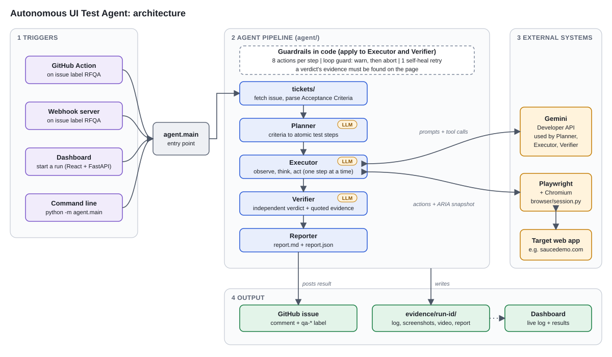
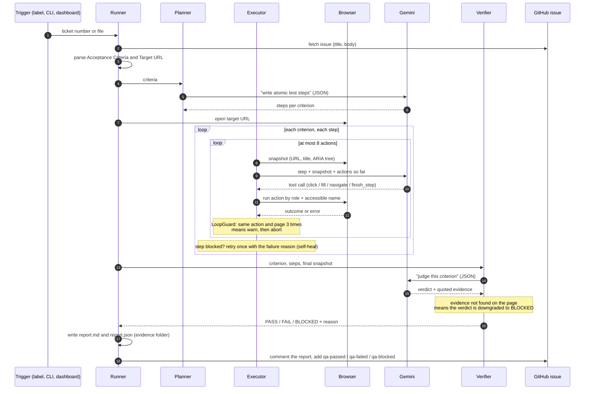

# Architecture

How a ticket in "Ready for QA" (RFQA) becomes a PASS / FAIL verdict with evidence.

## System overview

PNG copy for slides and PDFs: [img/architecture-overview.png](img/architecture-overview.png). The purple, blue, orange and green boxes are triggers, agent pipeline, external systems and output; the **LLM** tag marks the three steps that call Gemini.

## One run, step by step

## Key design decisions

| Decision | Why |
|----------|-----|
| The page is shown to the model as an ARIA tree, and elements are named by **role + accessible name** | No CSS or XPath selectors, so tests survive markup changes. This is how a human describes a page. |
| **Planner, Executor and Verifier are separate LLM roles** with narrow prompts | The model that performs a step never judges it, which reduces self-confirming mistakes. |
| Verdict **evidence must appear verbatim** in what the agent observed | Guards against hallucinated results: an ungrounded PASS or FAIL becomes BLOCKED. |
| **Hard limits in code**, not only in prompts (8 actions per step, loop guard, one retry) | A runaway or confused model cannot loop forever. |
| The dashboard only **starts the agent CLI and reads its files** | The two projects stay decoupled; the agent works without the UI. |
